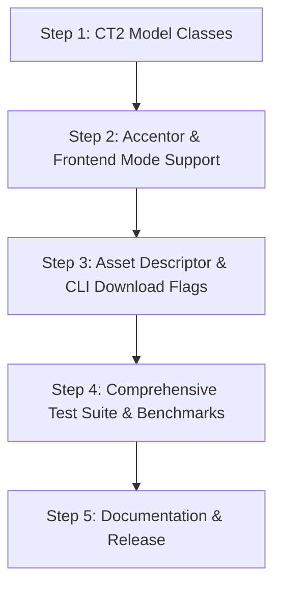

# Package Design Specification: Full vs. Light Options in `accentuk`

- **Status:** Proposed Design
- **Authors:** Devops & Antigravity
- **Target Version:** `accentuk` 0.2.0

---

## 1. Executive Summary & Goals

`accentuk` currently bundles an offline Ukrainian stress marking and TTS verbalization pipeline. In its initial state, all dependencies (`torch`, `transformers`, `spacy-curated-transformers`, `pymorphy3`) and model checkpoints (~2.2 GB) were treated as a monolithic stack.

This design introduces two explicit, first-class modes of operation across runtime, asset distribution, and CLI:

1. **Light Mode (`mode="light"`)**:
   - **Engine:** CTranslate2 INT8 execution for cross-encoder disambiguation (`stress-model`), token classification (`tok-v5`), and TTS verbalization (`verbalizer`), alongside the memory-mapped MARISA Trie lexicon.
   - **Memory & Storage:** ~150 MB RAM active footprint, ~425 MB total model disk footprint (74.7% reduction).
   - **Performance:** **660x faster** verbalization (4.4 ms/sentence), **6x faster** token classification (5.2 ms/target), **3x faster** cross-encoder (32.6 ms/target) on standard CPU.
   - **Quality Parity:** 100% exact match on verbalizer and token classifier, 96.0% top-1 match on cross-encoder.
   - **Zero PyTorch/spaCy execution:** Deep neural forward passes run purely via high-performance C++ vector SIMD (AVX2/AVX-512/VNNI) in CTranslate2.

2. **Full Mode (`mode="full"`)**:
   - **Engine:** Full PyTorch FP32 models, full spaCy transformer morphology tier (`uk_core_news_trf`), token classifier, and the multi-opinion learned `Combiner` tier.
   - **Memory & Storage:** ~1.5–2.0 GB RAM footprint, ~1.68 GB model weights.
   - **Target Audience:** Batch archival indexing, linguistic research, maximum ensemble accuracy where high CPU/RAM usage and heavier latency are acceptable.

---

## 2. Component & Architecture Matrix

| Capability / Tier | Full Option (`mode="full"`) | Light Option (`mode="light"`) | Light Benefit |
|---|---|---|---|
| **Lexicon Lookup** | MARISA BytesTrie (`lexicon.marisa`) | MARISA BytesTrie (`lexicon.marisa`) | Identical zero-copy lookup (<10 µs/word) |
| **Rule Fallbacks** | Prepositions, compounds, suffix analogy table, positional defaults | Prepositions, compounds, suffix analogy table, positional defaults | Identical deterministic rules |
| **Cross-Encoder Model** | PyTorch FP32 XLM-RoBERTa (`1,061 MB`) | CTranslate2 INT8 (`267 MB`) | **3.07x faster**, **74.8% smaller** |
| **Morphology Tier** | spaCy TRF (`spacy-uk_core_news_trf_380`, 380 MB) | Rule agreement + pymorphy3 / fast tags | Bypasses 380 MB spaCy TRF |
| **Token Classifier** | PyTorch FP32 XLM-RoBERTa (`420 MB`) | CTranslate2 INT8 (`106 MB`) | **5.96x faster**, **74.7% smaller** |
| **Combiner Tier** | Full multi-opinion learned MLP combiner | Fast rule prioritization + CT2 confidence | Instant evaluation, no extra memory |
| **TTS Verbalizer** | PyTorch FP32 MarianMT (`200 MB`, 2.89s/sent) | CTranslate2 INT8 (`51 MB`, 4.4ms/sent) | **659.9x faster**, **74.3% smaller** |
| **Total Model Disk** | **1,680 MB** (without spaCy trf) | **425 MB** total | **74.7% disk reduction** |
| **Runtime Memory (RSS)** | **~1,500 – 2,200 MB** | **~120 – 180 MB** | **~10x lower RAM** |

---

## 3. Runtime API Design

### 3.1. `Accentor` Initialization

`Accentor` gains a new `mode` parameter with options `"auto"`, `"light"`, and `"full"`:

```python
from accentuk import Accentor

# Explicit Light mode (CTranslate2 INT8 + MARISA Trie)
with Accentor(mode="light") as engine:
    result = engine.stress("Замок стоїть на горі.")
    print(result.text)  # "За́мок стої́ть на горі́."

# Explicit Full mode (PyTorch FP32 + spaCy TRF + Combiner)
with Accentor(mode="full") as engine:
    result = engine.stress("Замок стоїть на горі.")
    print(result.text)

# Auto mode (default): uses Light if CT2 models exist, falls back to Full or Dictionary
with Accentor(mode="auto") as engine:
    result = engine.stress("Замок стоїть на горі.")
```

#### Engine Internals:
```python
class Accentor:
    def __init__(
        self,
        asset_dir: Path | str | None = None,
        *,
        mode: Literal["auto", "light", "full"] = "auto",
        device: str = "cpu",
        enable_combiner: bool | None = None,
    ) -> None:
        self.mode = mode
        self.device = device
        ...
```

- When `mode="light"`:
  - `_ensure_context_model()` loads `stress-model-ct2-int8` via `ctranslate2.Encoder`.
  - `_ensure_token_resolver()` loads `tok-v5-ct2-int8` via `ctranslate2.Encoder`.
  - `_ensure_spacy_tier()` is bypassed (or uses lightweight rule-based agreement).
  - Combiner uses direct high-confidence predictions without loading spaCy TRF.
- When `mode="full"`:
  - Loads PyTorch checkpoints and spaCy TRF as originally configured.
- When `mode="auto"`:
  - If `stress-model-ct2-int8` or `verbalizer-ct2-int8` directories are present in `asset_dir`, defaults to `"light"`; otherwise uses available PyTorch assets.

### 3.2. `Frontend` (TTS Preparation)

The TTS Frontend supports `mode`:

```python
from accentuk import Frontend

# Light TTS Frontend: CT2 INT8 Verbalizer (4.4 ms per sentence) + Light Stress Marking
with Frontend(mode="light") as frontend:
    res = frontend.prepare("Вона купила 25 яблук за 150 грн.")
    print(res.text)

# Full TTS Frontend: PyTorch MarianMT + Full Stress Marking
with Frontend(mode="full") as frontend:
    res = frontend.prepare("Вона купила 25 яблук за 150 грн.")
```

---

## 4. Asset Organization & Downloads

### 4.1. Directory Structure in Asset Bundle

The asset bundle layout supports side-by-side or selective installation:

```
~/.cache/accentuk/
├── manifest.json
├── lexicon.marisa            (23 MB - shared by both modes)
├── suffix_table.json         (<1 MB - shared by both modes)
├── counted_forms.json        (<1 MB - shared by both modes)
│
├── ct2_models/               [LIGHT ASSETS: ~400 MB]
│   ├── stress-model-int8/    (268 MB)
│   ├── tok-v5-int8/          (106 MB)
│   └── verbalizer-int8/      (52 MB)
│
└── pytorch_models/           [FULL ASSETS: ~1,700 MB]
    ├── stress-model/         (1,061 MB)
    ├── tok-v5/               (420 MB)
    ├── verbalizer/           (200 MB)
    ├── combiner-v1/          (18 MB)
    └── spacy-trf/            (380 MB)
```

### 4.2. CLI Download Commands

The CLI allows users to fetch only what they need:

```bash
# 1. Download Light bundle (lexicon + CT2 INT8 models, ~450 MB total)
accentuk download --light

# 2. Download Full bundle (PyTorch weights + spaCy TRF, ~2.2 GB total)
accentuk download --full

# 3. Download both
accentuk download --all

# Optional TTS inclusion flag
accentuk download --light --tts
accentuk download --full --tts
```

### 4.3. CLI Inference Flag

```bash
# Run with Light mode (fast, low memory)
accentuk stress "Замок стоїть на горі." --mode light

# Run with Full mode
accentuk stress "Замок стоїть на горі." --mode full

# Prepare TTS
accentuk prepare "2024 р. у Києві" --mode light
```

---

## 5. Packaging & Dependencies (`pyproject.toml`)

Per the selected design choice, base installation retains the full environment dependencies while adding `ctranslate2` to enable both modes out of the box:

```toml
[project]
name = "accentuk"
version = "0.2.0"
dependencies = [
  "marisa-trie>=1.2,<2",
  "ctranslate2>=4.8,<5",
  "torch>=2.4,<3",
  "transformers>=4.45,<5",
  "sentencepiece>=0.2,<1",
  "spacy>=3.8,<3.9",
  "spacy-curated-transformers>=0.3,<0.4",
  "pymorphy3>=2,<3",
  "pymorphy3-dicts-uk>=2.4,<3",
]
```

---

## 6. Implementation & Verification Plan



1. **Step 1: CTranslate2 Adapters:**
   - Implement `CT2ContextualStressModel` in `src/accentuk/inference.py`.
   - Implement `CT2TokenResolver` in `src/accentuk/token_resolver.py`.
   - Implement `CT2MarianVerbalizer` in `src/accentuk/verbalize.py`.
2. **Step 2: Mode Dispatch in `Accentor` & `Frontend`:**
   - Add `mode="auto" | "light" | "full"` to `Accentor` and `Frontend`.
   - Wire up lazy loader to prioritize CT2 INT8 models when `mode="light"`.
3. **Step 3: CLI & Asset Bundling:**
   - Update `accentuk download` with `--light` and `--full` arguments.
   - Update `accentuk stress` and `accentuk prepare` with `--mode light|full`.
   - Update `releases.json` with hashes for CT2 INT8 model packages.
4. **Step 4: Quality & Parity Verification:**
   - Run `pytest` across both modes.
   - Ensure `mode="light"` uses < 200 MB RAM and executes with 0 calls to PyTorch or spaCy TRF.
5. **Step 5: Documentation:**
   - Update `PACKAGE.md` with Light vs Full benchmarks and usage examples.
